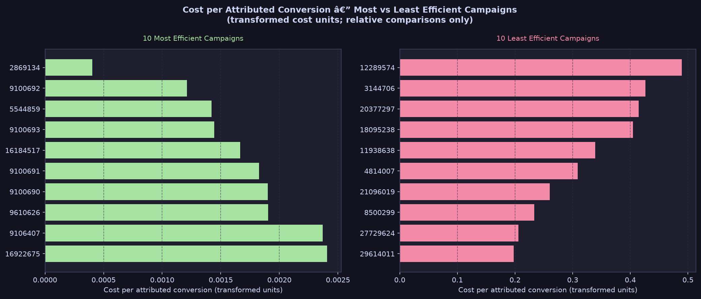
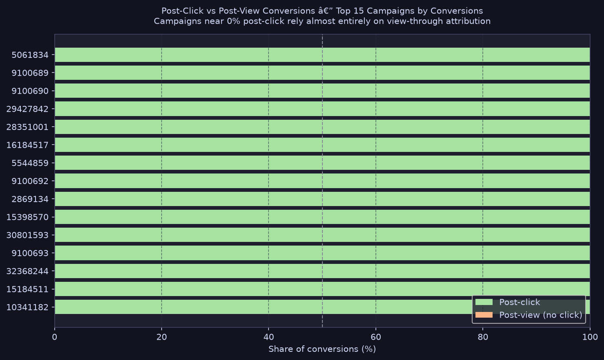
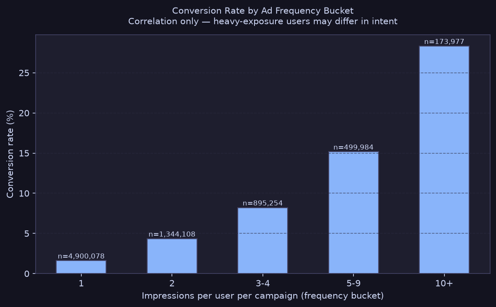

# Ad Campaign Performance and Attribution Analytics (Criteo, DuckDB)

> Analyzing a user-level sample of real display-ad data to find which campaigns waste spend, where the funnel leaks, how conversion changes with ad frequency, and how attribution model choice reshapes campaign rankings — synthesized into a product memo and an interactive Streamlit dashboard.

---

## Business Problem

Digital advertising platforms face a persistent allocation challenge: budget flows to campaigns based on historical bids and volume, not necessarily efficiency. Without a clear view of which campaigns deliver the most attributed conversions per unit of spend — and whether frequency caps could unlock savings — advertisers and platform teams lack the signal to act.

This project uses a 30-day Criteo impression dataset to answer five questions:
1. Which campaigns are over-spending relative to their conversion output?
2. Where does the funnel leak, and is leakage click-driven or view-driven?
3. Does conversion likelihood change with ad frequency, and is there a point of diminishing returns?
4. How does the choice of attribution model (last-touch, first-touch, linear, time-decay) shift campaign credit?
5. How long after an impression or click does a conversion typically occur, and what does that imply for the attribution window?

The findings are synthesized into a one-page product memo with a concrete recommendation and testable hypothesis, and exposed through an interactive six-page Streamlit dashboard.

---

## Data

**Source:** [Criteo Attribution Modeling for Bidding dataset](https://huggingface.co/datasets/criteo/criteo-attribution-dataset) — published by Criteo and hosted on Hugging Face.

**Citation:** Eustache Diemert, Julien Meynet, Pierre Galland, Damien Lefortier. *Attribution Modeling Increases Efficiency of Bidding in Display Advertising.* ADKDD'17.

**Key facts:**
- One row per ad impression, sorted by timestamp, spanning ~30 days of live Criteo traffic
- This project uses a **5% user-level sample** (`hash(uid) % 20 = 0`), keeping each user's full journey intact
- Final sample: **823,604 impressions** across **307,695 users** and **191 qualifying campaigns** (≥1,000 impressions)

**Important caveats:**
- `cost` and `cpo` columns are **transformed by Criteo** — not real currency. All cost comparisons are relative.
- `cat1`–`cat9` are anonymized categorical features with unknown meaning; not interpreted here.
- Data is **advertiser-side only** — no publisher or placement information.

**License:** Check the [dataset page](https://huggingface.co/datasets/criteo/criteo-attribution-dataset) for current terms before use. Credit Criteo in any public work.

---

## Approach

```
Download TSV.gz → Load 5% user sample (DuckDB) → Stage + clean NULLs
    → Spend efficiency analysis → Funnel analysis → Frequency analysis
    → Attribution model comparison → Conversion lag analysis
    → Reconciliation checks → Charts → Budget simulation → Product memo
    → Interactive Streamlit dashboard
```

Each analysis step is a versioned SQL file in `sql/`. Results are saved to `results/*.csv`. Static charts are generated by `make_charts.py`. The interactive dashboard (`app.py` + `pages/`) reads from the same CSVs.

---

## Key Findings

> **Fill in after running your queries.** Replace bracketed placeholders with real numbers from your CSV outputs. Charts are embedded below once generated.

### Finding 1 — Spend concentration without conversion payoff


The top 20% of campaigns by spend (38 of 191) account for **60.3% of total transformed cost** but deliver only **41.7% of attributed conversions** — an 18.6 percentage-point efficiency gap. The least efficient campaign costs **1,212× more** per attributed conversion than the most efficient.

### Finding 2 — Funnel: only 53% of conversions are attributed to Criteo


Across the 191 qualifying campaigns: 17,175 total conversions, of which **9,159 (53.3%) are attributed to Criteo**. All conversions in this dataset occurred with a click in the attribution path (`share_conversions_with_click = 100%`), confirming Criteo's last-click attribution rule.

### Finding 3 — Strong frequency-conversion relationship (correlation)


Users who saw a campaign's ads **10+ times** converted at **28.2%**, vs **1.6%** for users who saw just 1 ad — a **17.5× difference**. However, heavy-exposure users may have higher intent regardless of ad volume.

---

## Recommendation

Cap ad frequency at **10 impressions per user per campaign per 7-day window** and reallocate freed budget to the most efficient campaigns. See [`docs/memo.md`](docs/memo.md) for the full memo including test design and caveats.

---

## Limitations

1. **Observational data.** All findings are correlations. The frequency–conversion relationship is confounded by user intent. An A/B frequency-cap experiment (described in the memo) is needed to establish causation.
2. **5% sample.** Point estimates may differ from the full dataset. Re-run on full data before production decisions.
3. **Transformed cost.** No absolute monetary conclusions can be drawn.
4. **Single attribution rule.** The `attribution = 1` flag uses Criteo's own rule. The attribution model comparison (SQL 07) shows how last-touch, first-touch, linear, and time-decay rules shift campaign rankings.
5. **No publisher data.** Publisher-side effects of any recommendation cannot be measured here.

---

## How to Run

### 1. Install dependencies
```bash
# Windows
python -m venv .venv
.venv\Scripts\activate
pip install -r requirements.txt
```

### 2. Download the dataset
```bash
huggingface-cli download criteo/criteo-attribution-dataset \
  criteo_attribution_dataset.tsv.gz --repo-type dataset --local-dir data
```
If login is required, accept the dataset terms on Hugging Face first (`huggingface-cli login`).

### 3. Run all SQL analyses
```bash
python run_all.py
```

### 4. Generate charts
```bash
python make_charts.py
```

### 5. Run the interactive dashboard
```bash
streamlit run app.py
```

### 6. Read the memo
Open [`docs/memo.md`](docs/memo.md) for the full one-page product recommendation.

---

## Repo Structure

```
criteo-attribution-analytics/
├── data/                         ← gitignored; put criteo_attribution_dataset.tsv.gz here
├── sql/
│   ├── 01_load_sample.sql        ← 5% user-stratified sample
│   ├── 02_staging.sql            ← NULL cleanup, sanity checks
│   ├── 03_spend_efficiency.sql   ← Campaign cost & conversion efficiency
│   ├── 04_funnel.sql             ← Funnel leakage & click/view split
│   ├── 05_frequency.sql          ← Frequency bucket conversion rates
│   ├── 06_reconciliation.sql     ← Validation checks
│   ├── 07_attribution_models.sql ← Last-touch / first-touch / linear / time-decay comparison
│   └── 08_conversion_lag.sql     ← Time from impression/click to conversion
├── results/                      ← CSV outputs (generated by run_all.py)
│   ├── campaign_performance.csv
│   ├── funnel_by_campaign.csv
│   ├── frequency_buckets.csv
│   ├── frequency_top5_campaigns.csv
│   ├── attribution_model_comparison.csv
│   ├── attribution_rank_shifts.csv
│   ├── conversion_lag_buckets.csv
│   ├── click_to_conv_lag.csv
│   └── budget_simulation.csv
├── charts/                       ← PNG charts (generated by make_charts.py)
├── pages/                        ← Streamlit multi-page app pages
│   ├── 1_Campaign_Summary.py
│   ├── 2_Attribution_Models.py
│   ├── 3_Funnel_and_Spend.py
│   ├── 4_Frequency_Analysis.py
│   ├── 5_Conversion_Lag.py
│   └── 6_Budget_Simulation.py
├── docs/
│   ├── metric_dictionary.md      ← Definitions for every metric used
│   └── memo.md                   ← 1-page product recommendation memo
├── app.py                        ← Streamlit dashboard home / landing page
├── run_all.py                    ← Runs all SQL files end-to-end
├── make_charts.py                ← Generates all 5 static charts
├── budget_simulation.py          ← Budget reallocation simulation script
├── uplift_analysis.py            ← Uplift / A/B analysis utilities
├── requirements.txt
└── README.md
```

---

## Credit

- Dataset: Criteo Attribution Modeling for Bidding — Eustache Diemert et al., ADKDD'17
- SQL engine: [DuckDB](https://duckdb.org/) — in-process OLAP database
- Dashboard: [Streamlit](https://streamlit.io/) + [Plotly](https://plotly.com/python/)
